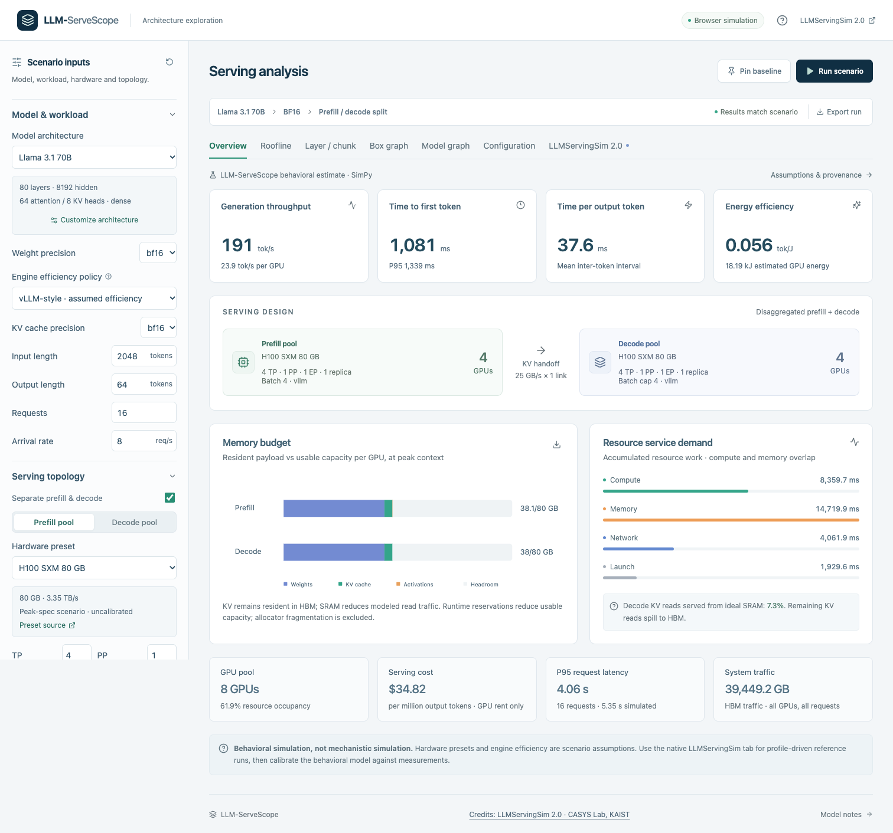

# LLM-ServeScope

**Behavioral modeling of LLM serving, backed by a SimPy discrete-event simulation.**

LLM-ServeScope combines operation-level compute, memory and network cost models
with serving-resource scheduling to estimate **throughput, latency, memory,
energy and utilization**. It reports system totals, per-GPU performance and
energy efficiency such as **output tokens per GPU-second and output tokens per
Joule**.

Use it to compare GPU specifications, model architectures, parallelism, batching,
and colocated versus separate prefill/decode servers. It is intended for
architecture exploration, capacity planning, marketing and strategy scenarios
where the critical hardware characteristics are available but a full deployment
is not. Hardware inputs and assumptions remain visible and exportable.

[Browser edition](https://ryeii.github.io/LLM-ServeScope/) ·
[Configuration guide](docs/configuration.md) ·
[Methodology](docs/methodology.md) ·
[Third-party credits](THIRD_PARTY_NOTICES.md)

The browser edition becomes available after GitHub Pages is configured to deploy
from the `production` branch, **`/(root)`**.



## What it models

A request arrives, forms a microbatch, passes through chunked prefill, optionally
transfers its KV cache, and completes decode iterations. SimPy models queueing,
replica admission, pipeline stages, shared resources and KV-transfer contention.
Closed-form operation costs combine compute throughput, HBM traffic, SRAM spill,
collectives and the configured network hierarchy.

- Eight GPU presets plus custom hardware: A100, H100, H200, B200, L40S,
  RTX 4090, RTX PRO 6000 and AMD MI300X.
- Ten model presets across Llama 3.1, Qwen3 and Mixtral, plus custom uniform
  dense/MoE decoder geometry with MHA, GQA or MQA attention.
- Independent prefill/decode hardware, TP/PP/EP, replicas, engine-efficiency
  policies, batch caps, active-batch limits and memory reservations.
- Separate weight/KV precision, chunk sizes, hierarchical fabrics, parallel KV
  links, power assumptions and GPU-hour cost inputs.

## Outputs

| View          | Outputs                                                                                                                                            |
| ------------- | -------------------------------------------------------------------------------------------------------------------------------------------------- |
| Overview      | Generation/prompt throughput, TTFT, TPOT, P95 latency, GPU count, resource occupancy, energy, tokens/J, tokens/GPU-second and assumed serving cost |
| Memory        | Per-GPU weight, KV and activation payload, usable capacity and headroom                                                                            |
| Roofline      | Compute/memory ceilings and per-operation arithmetic intensity and attainment                                                                      |
| Layer / chunk | Per-operation compute, memory, network and service costs; CSV export                                                                               |
| Box graph     | Simulated pipeline/resource timeline and request-latency distributions                                                                             |
| Model graph   | Interactive representative computation DAG with KV and residual branches                                                                           |
| Configuration | Complete resolved inputs, source revisions, assumptions and SHA-256 fingerprint                                                                    |

Pin a baseline, edit a scenario and run again to compare metrics. Export/import
scenario JSON, export complete results and download SVG charts. Changed inputs
are applied only when **Run scenario** is selected.

## Limitations: behavioral, not mechanistic simulation

**LLM-ServeScope is a behavioral simulation, not a mechanistic simulation.**
It abstracts hardware and serving behavior into operation costs and discrete-event
resource reservations. It does not reproduce individual GPU instructions,
cycle-level execution, page-level memory accesses, memory-controller transactions,
cache replacement or physical network packets. Its box graph contains modeled
scheduling intervals, not a captured hardware execution trace.

- Peak specifications, efficiency policies, ideal KV SRAM reuse, uniform MoE
  routing, activation traffic and energy coefficients are explicit assumptions.
  Useful sensitivity comparisons do not establish absolute prediction accuracy.
- Decision-grade estimates require calibration against operation latency grids,
  memory traffic/capacity, collectives, scheduling and idle/active power data for
  the actual hardware, model and engine configuration.
- Fixed prefill microbatches may split on decode; the behavioral engine does not
  merge groups or implement native vLLM continuous batching.
- The custom architecture model covers uniform causal decoder blocks with
  RMSNorm, RoPE and SwiGLU, optional QK normalization and routed experts. MLA,
  hybrid/sliding attention, shared experts, vision encoders and SSM layers need
  additional operation models.
- Capacity checks include modeled payload/workspace and explicit reservations.
  Allocator fragmentation, unspecified runtime overhead, quantization conversion
  cost and numerical quality are outside the model.
- Energy covers GPUs, not host CPUs, network equipment or cooling. Resource
  occupancy is not tensor-core utilization. Hourly GPU costs are user assumptions.
- Simulation does not execute model kernels, generate natural-language text, or
  validate a new chip. No accuracy claim from another simulator is inherited.

The optional native reference path uses profile-driven LLMServingSim 2.0 and
ASTRA-Sim. It does not turn the behavioral model into a mechanistic GPU or memory
simulator. Use detailed traces or an appropriate mechanistic simulator when
instruction-, cycle-, page- or transaction-level behavior is the question.

## Credit to LLMServingSim 2.0

LLMServingSim 2.0 is developed by **CASYS Lab at KAIST**. Credit goes to
**Jaehong Cho, Hyunmin Choi, Guseul Heo and Jongse Park** for
_LLMServingSim 2.0: A Unified Simulator for Heterogeneous and Disaggregated LLM
Serving Infrastructure_ (ISPASS 2026).

- [Official repository](https://github.com/casys-kaist/LLMServingSim)
- [Paper](https://arxiv.org/abs/2602.23036)
- [Documentation](https://llmservingsim.ai/)
- [Retained MIT license](licenses/LLMServingSim-MIT.txt)

The local reference integration runs its pinned serving scheduler, measured
operation profiles, Chakra DAG generator and compiled ASTRA-Sim backend. Some
model geometries and the RTX PRO 6000 hardware reference also come from the
pinned upstream configuration. The behavioral equations, strategy controls,
visualizations and browser execution layer are independently implemented in
LLM-ServeScope. This project is not an official KAIST release or endorsement.

```bibtex
@inproceedings{cho2026llmservingsim,
  author = {Jaehong Cho and Hyunmin Choi and Guseul Heo and Jongse Park},
  title = {{LLMServingSim 2.0: A Unified Simulator for Heterogeneous and Disaggregated LLM Serving Infrastructure}},
  booktitle = {2026 IEEE International Symposium on Performance Analysis of Systems and Software (ISPASS)},
  year = {2026},
  doi = {10.1109/ISPASS69572.2026.00012}
}
```

## GitHub Pages edition

The `production` branch contains prebuilt static files at its root. The same
`backend/model.py` and SimPy 4.1.1 run inside a **Pyodide Web Worker**. Scenario
inputs stay in the browser; no Python web server, API service, Hugging Face token,
model weights or GPU is required. The Python/WebAssembly runtime and SimPy are
bundled with the site and served from the same origin. The first load downloads
the runtime before the first calculation.

The browser supports the behavioral controls, six output families and exports.
The native LLMServingSim/ASTRA-Sim executable is available only in the local
edition; the native tab explains how to install it locally.

To deploy this repository as requested:

1. Open **Settings → Pages**.
2. Select **Deploy from a branch**.
3. Select **`production`** and **`/(root)`**, then save.

To rebuild and update that branch after committing source changes:

```bash
npm ci
npm run build:pages
# Optional local static preview at /LLM-ServeScope/:
npx vite preview --outDir dist-pages --base /LLM-ServeScope/ --host 127.0.0.1 --port 4182
# Publish the build to production without switching the source checkout:
npm run publish:pages
```

The default base path is `/LLM-ServeScope/`. Override `SERVESCOPE_BASE_PATH` if the
repository is hosted at another path. The publish script requires a clean source
checkout and an authenticated `origin`, preserves production history, and refuses
to replace a deployment built from source that has not been pushed to `origin`.

## Local installation

Requires Node.js 22+ and Python 3.10+.

```bash
git clone https://github.com/ryeii/LLM-ServeScope.git
cd LLM-ServeScope
./scripts/start.sh
```

Open **http://127.0.0.1:8788/**. This serves the UI and Python API on loopback only.
Set `SERVESCOPE_PORT` to change the port. Behavioral simulation runs on CPU and
needs only SimPy. For frontend development, run the API and `npm run dev` in
separate terminals; Vite uses http://127.0.0.1:4180/.

For the optional native reference backend on macOS ARM64, install CMake,
Python 3.10 and a C++ compiler, then run:

```bash
./integration/setup_native.sh
```

Native profiles currently support Llama 3.1 8B BF16 on RTX PRO 6000 (TP1/TP2) and
RTX4090 (TP1). New compute hardware requires appropriate measured profiles;
custom peak TFLOPS alone do not supply them. See the
[native integration guide](integration/README.md).

## Reproducibility and validation

```bash
.venv/bin/python -m unittest discover -s tests -v
npm run build
npm run build:pages
PLAYWRIGHT_BROWSERS_PATH=.cache/playwright npx playwright install chromium
PLAYWRIGHT_BROWSERS_PATH=.cache/playwright npm run test:ui
PLAYWRIGHT_BROWSERS_PATH=.cache/playwright npm run test:pages
```

Checks cover model geometry, source pins, token accounting, queue causality,
capacity rejection, phase policies, browser/local numeric parity, nested Pages
paths, static-only simulation, imports/exports, native graphs and responsive UI.
Native evidence checks are skipped when optional retained artifacts are absent.
The native browser test requires a built local native backend.

Examples: [heterogeneous servers](examples/heterogeneous-scenario.json),
[custom decoder](examples/custom-decoder-scenario.json). Native run receipts are
summarized in [the comparison manifest](examples/native-comparison.json); full
runtime outputs and compiled dependencies are ignored by Git. Historical receipt
hashes remain unchanged across the product rename.

LLM-ServeScope explores system-level serving behavior. The separate LLM-MemScope
project visualizes detailed recorded and modeled memory events.
