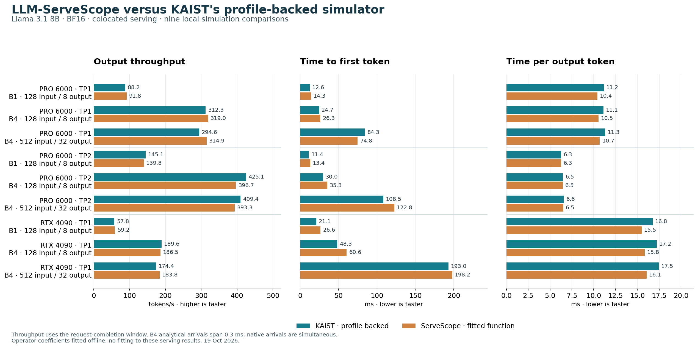

# Fitted GPU function versus native KAIST serving simulation

19 October 2026. All nine Llama-3.1-8B BF16 scenarios use the same fitted GPU
function as unprofiled hardware; there is no table override at known identities.
Coefficients are fitted from operator measurements, not these end-to-end metrics.
This is an integration check on profiled configurations. Withheld-data prediction
tests are documented separately in [calibration.md](../../calibration.md).

| Metric | Original roofline mean absolute relative difference | Fitted-function difference |
|---|---:|---:|
| Output throughput | 13.54% | 4.10% |
| Time to first token | 29.98% | 14.83% |
| Time per output token | 10.82% | 4.65% |

Throughput differences range from −6.68% to +6.90%. These are comparisons with the
native simulator's profile-backed results, not new end-to-end GPU measurements.
Network, queueing and endpoint semantics still differ, and operator fit residuals
are intentionally retained. The new path also adds explicit embedding,
final-normalization and sampling costs; the aggregate improvement is not a pure
ablation of coefficient fitting alone.



| GPU | TP | Batch | Input → output | Roofline tok/s | Fitted tok/s | Native tok/s | Fitted difference |
|---|---:|---:|---:|---:|---:|---:|---:|
| RTX PRO 6000 | 1 | 1 | 128 → 8 | 78.02 | 91.79 | 88.22 | +4.05% |
| RTX PRO 6000 | 1 | 4 | 128 → 8 | 281.08 | 318.99 | 312.32 | +2.14% |
| RTX PRO 6000 | 1 | 4 | 512 → 32 | 260.79 | 314.88 | 294.56 | +6.90% |
| RTX PRO 6000 | 2 | 1 | 128 → 8 | 124.68 | 139.76 | 145.11 | -3.69% |
| RTX PRO 6000 | 2 | 4 | 128 → 8 | 377.38 | 396.73 | 425.15 | -6.68% |
| RTX PRO 6000 | 2 | 4 | 512 → 32 | 367.42 | 393.30 | 409.37 | -3.93% |
| RTX 4090 | 1 | 1 | 128 → 8 | 49.18 | 59.21 | 57.78 | +2.48% |
| RTX 4090 | 1 | 4 | 128 → 8 | 152.06 | 186.55 | 189.59 | -1.61% |
| RTX 4090 | 1 | 4 | 512 → 32 | 141.94 | 183.81 | 174.39 | +5.40% |

All metrics, fit residuals and provenance are retained in [comparison.json](comparison.json),
[comparison.csv](comparison.csv) and [operators.csv](operators.csv). The JSON
records both the base commit and hashes of the actual working-tree implementation.

The native backend uses pristine pinned sources and the same 456 verified artifacts
as the controlled reference runs. Throughput uses earliest arrival to final request
completion; native TP2's additional 1 ms control tail is reported separately.
Analytical batch-four arrivals span 0.3 ms versus simultaneous native arrivals.
Single-request arrivals match. Capacities and bandwidth units are aligned.

No coefficients were fitted to these nine serving outputs. They exercise known
hardware/model identities, so their agreement does not independently validate a
new GPU. Energy was not calibrated. See [full method and validation](../../calibration.md)
and the [original comparison](../roofline-vs-profiles-2026-10-19/README.md).

Reproduce from the repository root:

```sh
.venv/bin/python -B integration/compare_roofline_profiles.py \
  --timing-mode calibrated --output runs/calibrated-profile-comparison-2026-10-19
```
