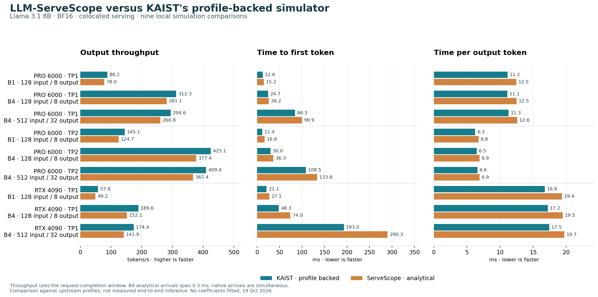

# ServeScope analytical timing versus KAIST profiles

Comparison conducted 19 October 2026. **Across nine controlled simulations,
ServeScope predicted 10.0–19.8% less output throughput than the native KAIST
profile-backed simulator.** Mean absolute relative differences were 13.54% for
throughput, 29.98% for time to first token, and 10.82% for time per output token.
Every latency difference was positive in this suite: ServeScope was slower.

These are differences between simulators, not measured prediction errors against
real end-to-end inference. We executed the pinned native LLMServingSim scheduler,
Chakra converter and compiled ASTRA-Sim backend locally using KAIST's retained
operator profiles. We did not run GPU inference, collect new profiles, or reproduce
the exact experiments in the paper. No analytical coefficients were fitted and no
production timing or scheduling equations were changed.



## Output throughput

All runs use Llama 3.1 8B, BF16 weights/activations and BF16 KV, colocated serving,
one replica, PP1/EP1, no prefix sharing or offload. TP2 uses two GPUs; TP1 uses one.
B denotes requests in the batch; input and output lengths are per request.
Throughput is output tokens divided by the request-completion window, not
steady-state saturated throughput.

Difference = 100 × (ServeScope / KAIST − 1).

| GPU | TP | B | Input → output tokens | ServeScope tok/s | KAIST tok/s | Difference |
|---|---:|---:|---:|---:|---:|---:|
| RTX PRO 6000 | 1 | 1 | 128 → 8 | 78.02 | 88.22 | -11.56% |
| RTX PRO 6000 | 1 | 4 | 128 → 8 | 281.08 | 312.32 | -10.00% |
| RTX PRO 6000 | 1 | 4 | 512 → 32 | 260.79 | 294.56 | -11.46% |
| RTX PRO 6000 | 2 | 1 | 128 → 8 | 124.68 | 145.11 | -14.08% |
| RTX PRO 6000 | 2 | 4 | 128 → 8 | 377.38 | 425.15 | -11.24% |
| RTX PRO 6000 | 2 | 4 | 512 → 32 | 367.42 | 409.37 | -10.25% |
| RTX 4090 | 1 | 1 | 128 → 8 | 49.18 | 57.78 | -14.89% |
| RTX 4090 | 1 | 4 | 128 → 8 | 152.06 | 189.59 | -19.80% |
| RTX 4090 | 1 | 4 | 512 → 32 | 141.94 | 174.39 | -18.61% |

## Latency

Across all nine runs, time to first token was 6.2–53.2% longer in ServeScope;
time per output token was 5.0–15.6% longer. Representative batch-four, 128-input /
8-output results follow. Full precision and all cases are in comparison.csv.

| GPU / TP | ServeScope TTFT ms | KAIST TTFT ms | ServeScope TPOT ms | KAIST TPOT ms |
|---|---:|---:|---:|---:|
| RTX PRO 6000 / TP1 | 26.22 | 24.69 | 12.50 | 11.11 |
| RTX PRO 6000 / TP2 | 36.34 | 29.96 | 6.90 | 6.47 |
| RTX 4090 / TP1 | 74.03 | 48.32 | 19.47 | 17.21 |

## Individual operators: aggregate agreement hides offsetting differences

These costs are per operator, per GPU, for the first decode block on RTX PRO 6000,
TP1, batch four, after 128 input tokens. Native COMP_NODE costs represent whole
kernel elapsed time, including internal memory effects; they are not arithmetic-only
times. Comparing the same nine transformer-block operators across all runs gives
prefill-block differences of +5.3% to +62.1% and first-decode-block differences of
+5.0% to +15.5%, excluding communications and model endpoints from that matched sum.

| Decode operator | ServeScope μs | KAIST profile μs | Difference |
|---|---:|---:|---:|
| Input RMSNorm | 2.558 | 2.368 | +8.0% |
| QKV projection | 41.932 | 35.638 | +17.7% |
| Rotary position | 2.551 | 2.699 | -5.5% |
| Attention | 2.657 | 14.035 | -81.1% |
| Output projection | 28.805 | 25.653 | +12.3% |
| FFN RMSNorm | 2.558 | 2.368 | +8.0% |
| Gate + up projection | 186.546 | 157.527 | +18.4% |
| SwiGLU | 2.769 | 3.456 | -19.9% |
| Down projection | 94.440 | 81.024 | +16.6% |

Attention is about 5.3× faster in ServeScope's estimate, while large projections
are slower. End-to-end closeness therefore does not establish that every operator
or sensitivity is accurate. A single global efficiency adjustment could improve
one aggregate number while worsening individual operators.

ServeScope's analytical path combines ideal compute/memory overlap with assumed
efficiencies, a generic tiling heuristic, traffic/cache estimates and launch costs.
KAIST's path looks up/interpolates measured operator latencies and then simulates
the execution graph. The observed differences cannot be attributed solely to
the max(compute, memory) equation: operator coverage, cache/traffic assumptions,
scheduling and communications also differ. In particular, the native graphs
include embedding/final normalization/head work and TP endpoint collectives that
are not represented identically in the analytical path.

## Alignment, remaining differences and evidence

- Source under test: ServeScope main at `cf626870d056cf3d7a67cef8a4db5942badb4854`;
  unchanged analytical implementation. Exact source revision and script digest
  are also recorded in comparison.json.
- Native LLMServingSim pin: `b09c7aaab4b072d73136641841cc2688616c49eb`;
  ASTRA-Sim `d3d068f4050a2fb9a7538cc671a982152c2ba9b7`;
  Chakra `5e6e9b28438bc1899105dbdd68eed4cf61bee6fd`.
- Native backend: compiled analytical congestion-unaware ASTRA-Sim; KAIST tracked
  sources remain pristine. This is the integrated backend, not a claim about all
  possible upstream backends or the paper's precise validation configurations.
- Upstream profile metadata: RTX PRO 6000 Blackwell Server Edition uses
  vLLM 0.28.0 / CUDA 13.0; RTX 4090 uses vLLM 0.19.0 / CUDA 12.8. ServeScope's
  generic vLLM factor is not calibrated to these versions or individual kernels.
- Both paths use aligned decimal bandwidths (1597.6 or 1008 GB/s), memory capacities
  (96 or 24 GiB), a 16 GiB/s link (17.179869184 decimal GB/s), and 1000 ns link
  latency. Efficiency factors remain the existing .65 compute / .8 memory
  assumptions; TP collective implementations still differ.
- Native requests arrive simultaneously. The analytical public schema requires
  positive arrival rate; its maximum 10000 requests/s produces 0.1 ms spacing.
  Batch-four formation completes at 0.3 ms and contributes 0.15 ms mean TTFT delay.
  Single-request arrivals match exactly. This small mismatch is retained openly,
  rather than patching production code to manufacture an exact burst.
- All inputs fit one prefill chunk and the native 2048-token budget, so there is
  no intended multi-chunk prefill or cross-batch continuous scheduling in this suite.
- The native decode profile's KV axis counts existing tokens; the analytical
  first decode context includes the new query (input length + 1). Their kernel
  memory-traffic representations are not interchangeable.
- Throughput uses earliest arrival to last completion for both paths. Native TP2
  total clocks include an additional 1 ms control tail; the original total-clock
  throughput is retained separately in the CSV/JSON rather than mixed into the
  comparison. TTFT and TPOT come from the original request CSVs.
- Verified all 456 inventoried native artifacts against their recorded sizes and
  SHA-256 hashes. Recomputed request-window throughput from the original CSVs.
  All nine simulator runs completed; no native warning messages were emitted.
- This small, controlled Llama-8B suite does not establish accuracy for H100/B200,
  other models, MoE, different precision, larger batches, sustained arrival loads,
  or clock/bandwidth sweeps. Energy is excluded because accounting scopes differ.

The analytical model remains useful for exploratory scenarios. Customer-facing
quantitative predictions should use supported measured profiles or additional
hardware/software-specific calibration with independent validation. These results
do not validate the analytical model's flat clock-scaling response.

## Reproduce and inspect

From the repository root, after installing both environments and the native backend:

```sh
.venv/bin/python -B integration/compare_roofline_profiles.py \
  --output runs/roofline-profile-comparison-2026-10-19
MPLCONFIGDIR=/tmp/servescope-mpl .venv-sim/bin/python -B \
  integration/plot_profile_comparison.py \
  runs/roofline-profile-comparison-2026-10-19/comparison.json \
  runs/roofline-profile-comparison-2026-10-19/comparison.png
```

Existing completed native runs are reused after configuration and artifact-hash
checks; select a fresh output directory to execute all nine again. Native raw
artifacts remain under the gitignored runs/ directory. Summary data, profile/source
hashes, exact configurations/commands and per-operator comparisons are retained in
this version-controlled report directory.

- [Machine-readable report and provenance](comparison.json)
- [All end-to-end metrics](comparison.csv)
- [All 162 matched operator costs](operators.csv)
- [Chart as SVG](comparison.svg)
- [Native installation and integration](../../../integration/README.md)

KAIST methodology: [LLMServingSim 2.0, Sections IV-A–D](https://arxiv.org/html/2602.23036v2)
and [official profiler documentation](https://llmservingsim.ai/docs/profiler/overview).
KAIST CASYS Lab receives credit for the native simulator and profiles; ServeScope's
analytical extension and integration are by [ryeii (Ryan Z An)](https://github.com/ryeii).
