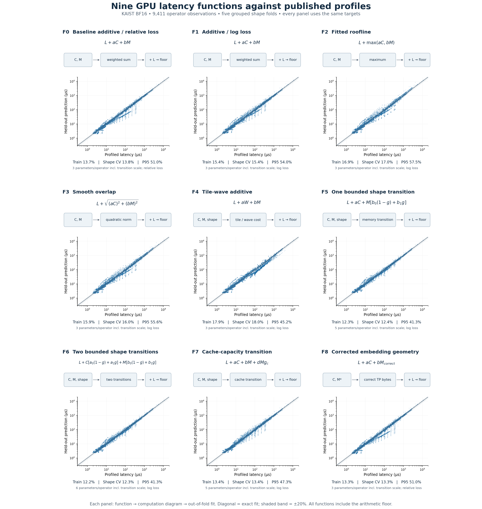
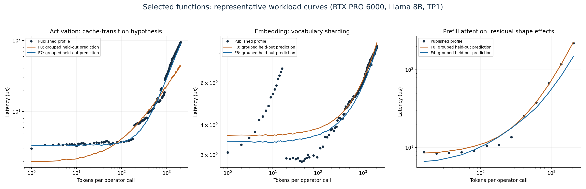
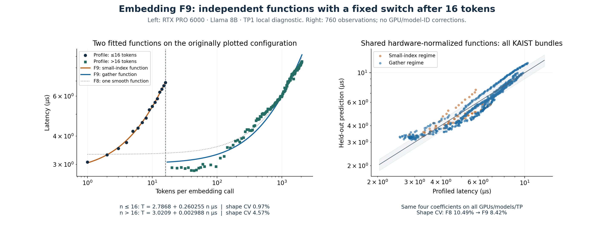
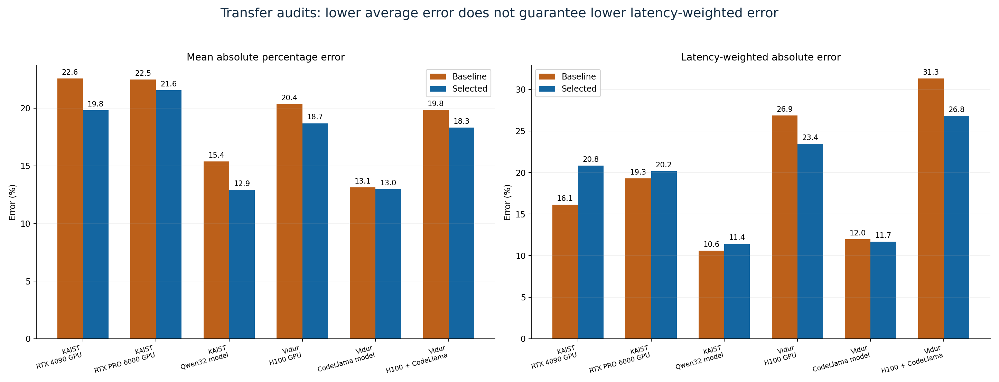

# LLM-ServeScope GPU timing: a simple-function search

Research report · 2026-10-19 · ryeii (Ryan Z An) / LLM-ServeScope

## Decision

Preserve the deployed three-term fit as **baseline F0**. The research selection
uses simple operator-specific functions and reduces KAIST grouped shape-validation
MAPE from **13.78% to 10.87%**.
It also improves several transfer averages, including the separately reserved
Vidur H100 corpus (**20.36% → 18.69%**).
However, KAIST GPU-transfer latency-weighted error worsens. **The evidence does
not justify replacing the deployed timing model or claiming accurate general
hardware forecasting yet.** Selected research coefficients are available in
[selected-functions.json](selected-functions.json); the application remains on F0.
No timing-table anchors, GPU-ID offsets, or exact-match corrections are introduced.

The result supports a small set of shape-aware corrections, not a large opaque
predictor. 8 of the fourteen KAIST operator groups keep F0; the final research
selection uses 48 parameters including discrete transition locations, versus
42 for F0. More elaborate functions do not consistently win.

## 1. Literature and the hypotheses tested

- **Roofline** motivates arithmetic and bandwidth limits. It supplies a bound and
  bottleneck description, not a guarantee that peak specifications predict every
  kernel. We retain a compute floor and test a fitted maximum. [Williams,
  Waterman and Patterson, Berkeley technical report](https://www2.eecs.berkeley.edu/Pubs/TechRpts/2008/EECS-2008-134.html).
- **NVIDIA's GEMM guide** explains tile padding, partial waves, and the effect of
  matrix dimensions on utilization. This motivates F4, but fixed guessed tiles
  are only a hypothesis: actual libraries select among kernels. [NVIDIA matrix
  multiplication guide](https://docs.nvidia.com/deeplearning/performance/dl-performance-matrix-multiplication/index.html).
- **Habitat** combines wave scaling with learned operator prediction. Its approach
  motivates distinguishing execution structure from peak-rate scaling; we do not
  reproduce its predictor or use reference timings at runtime. [Author repository](https://github.com/geoffxy/habitat).
- **NeuSight** predicts utilization at tile granularity and aggregates through
  hardware bounds. It argues for physically structured features rather than
  merely increasing predictor size. Its published FP32 measurements are useful
  follow-up data, but are not interchangeable with serving BF16/FP16 kernels.
  [Paper](https://arxiv.org/abs/2407.13853), [artifact](https://github.com/sitar-lab/NeuSight).
- **Vidur** separates token-level and sequence-level operators and fits profiled
  costs with random forests for its serving simulator. We use its published
  profiles to test our smaller functions independently; this is not a reproduction
  of Vidur's random forest or its reported end-to-end accuracy. [Paper](https://arxiv.org/abs/2405.05465),
  [published profiles](https://github.com/microsoft/vidur/tree/abae7f63aa857300f5cdc6f5e0d27860cd24721b/data/profiling/compute).
- **FlashAttention** motivates treating nominal bytes cautiously: tiled attention
  changes IO and reuse. None of our byte formulas is a hardware-counter measurement.
  [Paper](https://arxiv.org/abs/2205.14135).
- **PipeWeave** combines analytical pipeline features with learned efficiency and
  provides additional operator data. It is a possible next corpus, rather than
  an unreported part of the fit here. [Artifact](https://github.com/zksainx/pipeweave).

These sources motivate our function choices; their published accuracy numbers
are not comparable to our operator-level MAPE without matching datasets and tests.
The cache transition below is our hypothesis about these profiles, not a model
claimed to have been validated by any of these authors.

## 2. Is the data sufficient?

**Enough to compare compact functions within recorded conditions; insufficient to
identify a universal GPU/software performance function.** A dense grid increases
shape coverage, but thousands of points on one GPU do not create thousands of
independent hardware configurations.

| Source / revision | Use | Data / units | Environment and restrictions |
| --- | --- | --- | --- |
| KAIST LLMServingSim `b09c7aaab4b072d73136641841cc2688616c49eb` | Development + nested transfer audits | 9,411 BF16 pure-phase operator observations; integer ns | RTX PRO 6000 + RTX 4090; Llama 3.1 8B / Qwen3 32B; TP1/2; software differs between GPUs |
| Microsoft Vidur `abae7f63aa857300f5cdc6f5e0d27860cd24721b` | Independent corpus; no coefficient pooling with KAIST | 602,856 extracted observations → 590,040 distinct model/TP coordinates; CSV means in ms × 1e6 → ns | FP16; A100/A40/H100; Llama2 7B/70B + CodeLlama34B; TP1/2/4/8; exact historical CUDA/driver versions absent |
| NeuSight `6945927d9afcca2b9daf021f8395e53edc5b4eef` | Literature and dataset assessment only | Published FP32 operator CSVs with hardware/tile features | Not used to fit BF16/FP16 serving kernels; different precision/operators |
| PipeWeave `6cac920915b59947150f1d6d5732d29ef2948fe6` | Literature and dataset assessment only | Published GEMM/attention/RMSNorm/SiLU datasets and hardware JSON | Broader potential follow-up; not downloaded or mixed into this experiment |
| Habitat `5f01e523a1dc30dbfbaaa39cf4880a534c7781a2` | Literature and repository assessment only | Wave scaling and learned operator predictors | Inspected repository does not provide an equivalent ready-to-pool serving CSV corpus |

For Vidur, **262,240** observations on A100/A40 with Llama2 7B/70B form the
selection corpus. H100 Llama profiles (**131,120**) are excluded from coefficient
and family selection. CodeLlama34B is excluded on every GPU: **131,120** records on
seen GPUs test model transfer; **65,560** on H100 test GPU and model transfer together.
Some CodeLlama attention/projection shapes are identical to Llama70 shapes: model
identity transfer is therefore not automatically unseen-tensor-geometry transfer.
The separate novel-geometry audit below reports that distinction.
Repeated coordinates are aggregated by the median of the published means; the
original CSVs are retained, including their repeated rows and recorded statistics.
Independent measurements in different model/TP folders remain distinct, even
when their executed geometry matches. Only repeated coordinates within the same
model/GPU/TP are aggregated. No measurements or prompts were synthesized. No new GPU runs were collected.

We do **not** pool Vidur and KAIST coefficients. They differ in precision,
profiler/kernel implementations and environment documentation. Each corpus fits
and selects the same function space independently. Thus an H100 Vidur score is
evidence for the function-search procedure on that corpus, **not** direct validation
of KAIST-fitted ServeScope coefficients on H100.

### Hardware inputs and provenance

| GPU reference | Dense tensor TFLOP/s | Vector FP32 TFLOP/s | DRAM TB/s | SMs | L2 |
| --- | --- | --- | --- | --- | --- |
| RTX PRO 6000 | 503 | 125 | 1.5976 | 188 | 128 MiB |
| RTX 4090 | 165.2 | 82.6 | 1.008 | 128 | 72 MiB |
| A100 SXM80 | 312 | 19.5 | 2.039 | 108 | 40 MiB |
| A40 | 149.7 | 37.4 | 0.696 | 84 | 6 MiB |
| H100 SXM80 | 989 | 67 | 3.35 | 132 | 50 MiB |

The KAIST hardware YAML files provide bandwidth/SM/L2 metadata; their original
compute peaks in ServeScope are explicitly illustrative reference inputs, not
per-run measured sustained rates. F0 retains those inputs unchanged. The RTX 4090
study uses the YAML's 72 MiB L2 instead of the UI preset's zero cache reservation.
That cache feature affects F7 only. Cache capacity is distinct from a user-selected
SRAM reservation. Vidur GPU names/80GB capacities are confirmed by its SKU config;
SXM reference rates are consistent with its DGX documentation, but clocks and
power limits of each historical CSV run are unrecorded. Rates are assumptions,
not fitted device-ID features. Dense tensor rates use the FP32-accumulate
convention where specified; RTX 4090 BF16 165.2 TFLOP/s is distinct from higher
FP16-accumulate or sparse marketing rates. [NVIDIA Ada specification](https://images.nvidia.com/aem-dam/Solutions/Data-Center/l4/nvidia-ada-gpu-architecture-whitepaper-v2.1.pdf).

Sources: [KAIST hardware metadata](https://github.com/casys-kaist/LLMServingSim/tree/b09c7aaab4b072d73136641841cc2688616c49eb/profiler/perf),
[Vidur device definitions](https://github.com/microsoft/vidur/blob/abae7f63aa857300f5cdc6f5e0d27860cd24721b/vidur/config/device_sku_config.py),
[NVIDIA A100 specifications](https://www.nvidia.com/en-us/data-center/a100/),
[NVIDIA A40 specification](https://images.nvidia.com/content/Solutions/data-center/a40/nvidia-a40-datasheet.pdf),
[GA102 architecture, table 3](https://www.nvidia.com/content/PDF/nvidia-ampere-ga-102-gpu-architecture-whitepaper-v2.pdf),
[NVIDIA H100 specifications](https://www.nvidia.com/en-eu/data-center/h100/),
[A100 cache/SM description](https://docs.nvidia.com/deeplearning/performance/dl-performance-gpu-background/index.html),
[H100 cache description](https://docs.nvidia.com/cuda/archive/12.2.0/hopper-tuning-guide/index.html).

Exact raw source paths, SHA-256 hashes, revision and license are recorded in
[the Vidur manifest](../../third_party/vidur-profiles/manifest.json), the preserved
[baseline artifact](baseline-gpu-fit.json), and [study provenance](provenance.json).
The Vidur files are exact gzip archives, not converted summaries. Their MIT license
is retained in [licenses/Vidur-MIT.txt](../../licenses/Vidur-MIT.txt).

## 3. Function space and optimization

For every candidate, reported time is `max(1 ns, C, function)` where:

- `C = FLOPs / precision-specific peak rate`, in ns; vector operations use FP32 rate.
- `M = nominal bytes / DRAM bandwidth`, in ns. This is a regression feature, not
  actual DRAM traffic or a mandatory memory floor.
- `L` is an operator intercept. All intercepts/slopes are nonnegative.
- `W` estimates padded, underfilled tile-wave cost. GEMM assumes 128×128 output
  tiles; vector work assumes 1,024 elements per block; prefill assumes query
  tiles of 128. These fixed values are tested assumptions, not traced dispatch.
- `w` estimates output tiles per SM (vector elements use 1,024-element blocks).
  For F5/F6, `g = w/(w+s)` transitions between two bounded coefficients.
- For F7, `r = nominal bytes / L2 bytes`, `g_c = r/(r+s)`. This gives an extra
  nonnegative cost as the working set grows relative to cache. It does not estimate
  actual misses, effective L2 bandwidth, or cache residency.
- F8 keeps the original additive fitting procedure but corrects vocabulary-parallel
  embedding bytes to `n*(4*hidden + 8)` for FP16/BF16: read/write a full hidden row
  and an int64 token index. Vocabulary sharding does not shard hidden-row width.
  Other operators are identical to F0. This representation correction is isolated
  from additional function complexity.

Prefill and decode attention have separate coefficients; other operators each
have one function across token counts, hardware and model geometry. No GPU or
model ID enters the numerical features. Fold keys use canonical executed M/N/K or local vector/head geometry; nominal
TP and unrelated model dimensions cannot split identical work into different
folds. Detailed formulas and geometry are in
[data.py](../../integration/fit_study/data.py) and [functions.py](../../integration/fit_study/functions.py).

**F0** reproduces the existing active-set nonnegative relative least-squares
solver, including its tie behavior. **F1–F7** minimize mean squared log timing
residual, with the arithmetic floor inside optimization. F2/F3 use two deterministic
starts; other log-loss fits use a nonnegative linear initialization. Numerical convergence
is not a proof of a global optimum for these nonlinear fits. Slopes are
empirical coefficients, not identifiable compute/memory efficiencies.

The transition scale `s` is chosen from **0.125, 0.5, 2, 8, 32** using three inner
shape-grouped folds inside each training partition. An outer validation fold never
chooses its own threshold. F5/F7 have four numeric coefficients plus that discrete
scale; F6 has five coefficients plus the scale. We retain all trials, including
failed improvements. This is a deliberately small, literature-informed search,
not exhaustive symbolic regression over all possible functions.

### Chronology and amendments

1. Preserve F0 and define overlap, log-loss, tile-wave and bounded-transition trials
   F1–F6 in [protocol.json](protocol.json), before running the comparisons.
2. Initial development results reject a universal overlap/tiling fix. Activation
   curves show a size-dependent change in cost per byte. Add F7 to test a cache
   capacity hypothesis with one bounded transition.
3. Audit embedding semantics against the published profiler implementation. Add
   F8 to isolate the incorrect TP scaling in nominal embedding bytes.
4. Final split/source audit: group equivalent executed geometry across TP and
   models; replicated norms/sampler stay in one fold. Preserve separate model
   measurements when deduplicating, so a reserved model never contributes to
   a training target through cross-model averaging.
5. Rerun the complete comparison. For KAIST transfer audits, rerun **family selection
   as well as coefficient fitting** inside the training partition. Evaluate reserved
   Vidur GPU/model groups only after freezing the development selection.

[initial-search-summary.json](initial-search-summary.json) retains initial outcomes;
final tables use the preserved F0 solver exactly. The earliest exploratory numeric
solver was equivalent on well-conditioned groups but could choose a different
solution in rank-deficient groups; that was corrected before the final comparison.
This matters for transfer and is not treated as a separate accuracy improvement. Initial Vidur results also
precede the final per-model deduplication audit; they are exploratory records,
not valid final holdout evidence. All final results use the corrected adapter.

## 4. One diagram and fit for every optimization iteration



[Full-resolution SVG](function-iterations.svg). Every panel has the formula,
computation diagram, all 9,411 out-of-fold predictions, training error and shape-CV
error. The diagonal is an exact prediction; the band is ±20%. Extreme points are
retained. F0/F1 deliberately have the same formula to isolate the training loss.

| Trial | Function / loss | Parameters¹ | KAIST train | KAIST shape CV | KAIST CV P95 | Vidur shape CV | Vidur macro-op CV |
| --- | --- | --- | --- | --- | --- | --- | --- |
| F0 | Baseline additive / relative loss / relative | 3 | 13.73% | 13.78% | 50.97% | 13.31% | 15.67% |
| F1 | Additive / log loss / log | 3 | 15.36% | 15.41% | 54.00% | 14.11% | 17.96% |
| F2 | Fitted roofline / log | 3 | 16.88% | 16.96% | 57.51% | 14.50% | 19.55% |
| F3 | Smooth overlap / log | 3 | 15.89% | 15.95% | 55.62% | 14.08% | 17.67% |
| F4 | Tile-wave additive / log | 3 | 17.90% | 17.98% | 45.22% | 23.94% | 27.22% |
| F5 | One bounded shape transition / log | 5 | 12.30% | 12.37% | 41.26% | 12.88% | 16.19% |
| F6 | Two bounded shape transitions / log | 6 | 12.23% | 12.32% | 41.30% | 12.77% | 16.07% |
| F7 | Cache-capacity transition / log | 5 | 13.35% | 13.42% | 47.28% | 14.03% | 17.48% |
| F8 | Corrected embedding geometry / relative | 3 | 13.27% | 13.32% | 50.97% | 13.02% | 13.81% |

¹ Includes the discrete scale where present. These are percentages of individual
operator timing, not throughput error. Vidur's dense attention grid dominates its
micro-average, so macro-operator MAPE is shown too. F8 lowers Vidur embedding error
without adding free parameters; a larger model would have obscured that input error.

Changing to log loss increases some MAPEs. That is a real result: log loss balances
multiplicative over/underprediction, while relative squared loss has a different
asymmetric preference. The functions are selected using the declared validation
metric rather than assuming that either loss is always better.

## 5. Occam's rule and the research selection

Within each operator and corpus, find the lowest five-fold OOF MAPE. Retain any
candidate within `max(1 percentage point, standard error of paired fold differences)`
of that minimum, then choose the candidate with the fewest parameters. Break ties
by trial order. The fold standard error is a **parsimony heuristic**, not a
confidence interval: overlapping training folds are statistically dependent.

| Operator | Selected trial | Baseline shape CV | Selected shape CV |
| --- | --- | --- | --- |
| act_fn | F7 | 36.10% | 17.97% |
| attention:decode | F0 | 8.83% | 8.83% |
| attention:prefill | F4 | 24.34% | 20.78% |
| down_proj | F5 | 8.90% | 6.20% |
| embedding | F8 | 16.08% | 10.48% |
| final_layernorm | F0 | 4.87% | 4.87% |
| gate_up_proj | F0 | 7.84% | 7.84% |
| layernorm | F1 | 11.97% | 11.18% |
| lm_head | F0 | 2.57% | 2.57% |
| o_proj | F5 | 11.33% | 7.62% |
| qk_norm | F0 | 0.99% | 0.99% |
| qkv_proj | F0 | 10.15% | 10.15% |
| rotary_emb | F0 | 10.94% | 10.94% |
| sampler | F0 | 28.59% | 28.59% |

The selected KAIST composite has MAPE **10.87%**, P95
**36.62%**, and latency-weighted error
**9.12%**. Because family selection
reuses these OOF scores, this composite is an **optimistic development summary**,
not an unbiased post-selection test. Its fit on the development data does not
establish unseen-hardware accuracy.

The minimal extra terms are retained only where they earn a material improvement:
cache transition for activation, bounded memory transition for down/output projection,
and corrected embedding geometry. F4 wins the attention development comparison,
but its fixed tiles and unknown heterogeneous batch composition remain assumptions.
In particular, the KAIST adapter approximates prefill wave geometry using total
query count; this can be wrong for multi-sequence batches. F0 is preserved for
reference, and F4 is not presented as a verified kernel-dispatch model.

For example, the full-data activation fit is approximately
`T = max(C, 3367 ns + 1.984*M*r/(r+2))`, with `r=nominal_bytes/L2_bytes`
(the other fitted slopes are numerically near zero). It improves the size curve
but does not independently identify a measured cache bandwidth or cache-hit rate.
Down projection chooses the largest allowed transition scale, 32 waves, with a
large upper-regime slope: that boundary choice is an extrapolation warning,
not evidence that the asymptote is accurately measured.



[Vector version](selected-shapes.svg). Points are published times; lines connect
held-out predictions rather than fitted training predictions. This figure reveals
transitions hidden by a single aggregate error number. The embedding panel contains
a sharp 16-to-20-token timing drop that a single smooth fit does not represent.
A subsequent [embedding dispatch diagnosis](embedding-dispatch.md) links it to
PyTorch's source-defined small-index/gather boundary at 16 indices. F8 corrects
vocabulary-sharding geometry but **does not model that software dispatch change**.
The updated plot distinguishes the two regimes; the original nine-trial scores
and parameters remain unchanged. A separate [F9 follow-up](embedding-piecewise/README.md)
now fits two independent nonnegative affine functions, switched at the source-defined
boundary: **≤16 versus >16 tokens**. For this plotted configuration, grouped
five-fold errors are **0.97%** and **4.57%**, respectively. Sharing four coefficients
across all five KAIST bundles reduces embedding-only cross-validation error from
**10.49% (F8) to 8.42% (F9)** under identical stricter folds. Hardware-transfer
limitations and the post-hoc nature of this candidate are disclosed in the follow-up.



F9 is an executable research predictor with exported coefficients and held-out
predictions; it has not replaced the application's deployed baseline.

## 6. Transfer audits and the deployment decision

| Transfer test | N | Baseline mean → selected | Baseline P95 → selected | Baseline weighted → selected |
| --- | --- | --- | --- | --- |
| KAIST: gpu_rtx4090 | 1643 | 22.58% → 19.80% | 58.62% → 41.07% | 16.13% → 20.84% |
| KAIST: gpu_rtx6000 | 7464 | 22.47% → 21.56% | 69.64% → 59.08% | 19.29% → 20.15% |
| KAIST: model_qwen32 | 3732 | 15.38% → 12.92% | 55.90% → 40.86% | 10.61% → 11.41% |
| Vidur: gpu_h100_llama | 131120 | 20.36% → 18.69% | 62.10% → 54.01% | 26.86% → 23.45% |
| Vidur: model_codellama_seen_gpus | 131120 | 13.12% → 12.99% | 41.23% → 42.91% | 11.97% → 11.69% |
| Vidur: gpu_and_model_h100_codellama | 65560 | 19.84% → 18.31% | 60.89% → 53.84% | 31.32% → 26.82% |



[Vector version](transfer-audits.svg). Latency-weighted error is
`sum(abs(predicted-profiled))/sum(profiled)` over the supplied grid. It is not a
production traffic-weighted objective. MAPE weights each profile coordinate equally.

KAIST GPU/model tests **reselect families only on training data**. The RTX PRO 6000
holdout is trained only on RTX 4090/Llama data; QK normalization is unsupported and
excluded explicitly. The Qwen holdout also excludes QK normalization. No missing
operator group is scored as a correct prediction. More detailed per-operator audit
scores and coefficients are in [KAIST audits](kaist/audits.json) and
[Vidur audits](vidur/audits.json).

H100 was excluded from Vidur's family/parameter search. Several example H100 rows
were inspected beforehand to establish the CSV schema and units, so this is **not
a pristine blind test**. Previously published KAIST holdouts were also already
known. No reserved aggregate score was used to choose the final families. The
report records all regressions instead of tuning against those targets afterward.

A stricter audit retains only CodeLlama coordinates whose executed tensor geometry
was absent from development data:

| Reserved CodeLlama corpus | Novel tensor points | Baseline mean → selected | Baseline weighted → selected |
| --- | --- | --- | --- |
| model_codellama_seen_gpus | 4662 | 7.56% → 6.39% | 5.97% → 5.46% |
| gpu_and_model_h100_codellama | 2331 | 11.18% → 11.12% | 9.18% → 7.68% |

The excluded points have a new model label but already-seen operator geometry.
See [novel-geometry-audits.json](novel-geometry-audits.json) for seen/novel counts
and operator breakdown. This distinction prevents an attention grid with familiar
shapes from masquerading as entirely novel model prediction.

The selected functions generally reduce mean error in the tested transfers, but KAIST GPU
latency-weighted error worsens, and H100 error remains material. **Deployment
selection: keep F0 as the current baseline; retain the new functions as research
artifacts until a stronger hardware-transfer result is demonstrated.** We do not
change the app's throughput, latency or energy claims as a consequence of this study.

## 7. Why the remaining error cannot be solved by counting rows

The normalized `[1,C,M]` design for RTX PRO 6000 activation and sampler has rank
**2 rather than 3**. FLOPs and nominal bytes scale together, so their compute and
memory coefficients cannot be identified separately. Normalization is also nearly
collinear. Different coefficients can fit the observed GPU equally well and imply
different predictions on another GPU. [Diagnostics](diagnostics.json) retain ranks,
singular values, condition numbers and arithmetic-floor conflicts.

Four KAIST targets lie below the declared arithmetic floor. That flags a conflict
among nominal work, reference peak rate and measurement; it does not prove a GPU
exceeded a measured physical limit. No measured sustained clock, instruction count
or memory-counter data is available to resolve that conflict here.

The principal limitations are hardware diversity and feature/measurement semantics:

- KAIST's two GPUs use different vLLM/CUDA versions. Compute peaks in the strategy
  presets are partly illustrative. Hardware, software and reference-rate effects
  are confounded.
- Vidur adds three GPU references, but uses FP16 and does not document the exact
  historical environment per CSV. Its repeated means are not independent runs
  across driver/software versions.
- The same nominal FLOP/byte count can correspond to different tile dispatch,
  fused kernels, special-function demand, cache residency or KV partitioning.
  A coefficient absorbs these differences without explaining all of them.
- These grids contain no independent clock, cache-capacity or bandwidth sweeps.
  The cache-transition fit supports a size effect; it does not identify cache
  causality independently of other size-dependent kernel behavior.
- No non-NVIDIA, quantization, fused MoE, MLA, hybrid attention, real serving
  scheduler, communication, power or energy accuracy is established here.
- Large-grid shape CV mostly tests interpolation. It does not validate arbitrary
  larger contexts or future architectures. The H100 test is a hardware-rate
  extrapolation within a separately fitted Vidur corpus, not a universal bound.

### The next data that would be most valuable

Collect the same operator/shape suite on at least several GPU families under a
single recorded serving stack, including repeated independent runs. Retain exact
GEMM M/N/K, attention sequence lengths/heads/KV layout, dtype/accumulation, TP,
kernel names and launch dimensions, measured clocks/power, actual device SKU,
cache state, and timer methodology. Target transition regions, not only more
points on a dense regular grid.

For identifying hardware effects, clock/power sweeps and cache/bandwidth
microbenchmarks are more useful than another million correlated shape samples.
Reserve a genuinely unseen GPU/software configuration before expanding the
function space again. Keep measured end-to-end serving runs for a subsequent
integration validation; operator error can cancel in aggregate throughput.

## 8. Reproduce and audit

CPU-only; no HF token or GPU is needed because the targets are published profiles.
Tested with Python 3.10; versions/platform are recorded in each corpus result.
For a fresh checkout, first create the environment with
`python3.10 -m venv .venv-sim`. No upstream simulator checkout is needed for this study.

```sh
.venv-sim/bin/python -m pip install -r integration/requirements-fit-study.txt
# Raw pinned profiles are already archived with hashes and license.
OPENBLAS_NUM_THREADS=1 OMP_NUM_THREADS=1 VECLIB_MAXIMUM_THREADS=1 \
  .venv-sim/bin/python -u -B -m integration.fit_study.run --audit
.venv-sim/bin/python -B -m integration.fit_study.figures
.venv-sim/bin/python -B -m integration.fit_study.report
.venv-sim/bin/python -B -m unittest integration.fit_study.test_study -v
```

To refresh the external archive from an independently cloned Vidur checkout, use
`integration.fit_study.import_vidur`; it verifies the exact pinned revision and
tracked-file cleanliness before archiving. Runtime code never imports these
adapters, raw profiles, NumPy or SciPy. Optimizer caches are ignored by Git; compact
results retain full-fit and per-fold coefficients so figures can be reconstructed
without those caches. Candidate files record source/runner/protocol SHA-256 values;
stale caches are refused rather than silently reused.

Files: [KAIST results](kaist/results.json), [Vidur results](vidur/results.json),
[protocol](protocol.json), [provenance](provenance.json),
[selected functions](selected-functions.json), [diagnostics](diagnostics.json),
[offline implementation](../../integration/fit_study), and the PNG/SVG figures.

Credit: KAIST CASYS Lab for LLMServingSim 2.0 and its measured profiles; Microsoft
and Vidur contributors for published profiling artifacts; cited authors for their
methods. Function-search implementation, feature hypotheses, report and ServeScope
integration design: [ryeii (Ryan Z An)](https://github.com/ryeii). This report does
not imply endorsement by the research groups.
