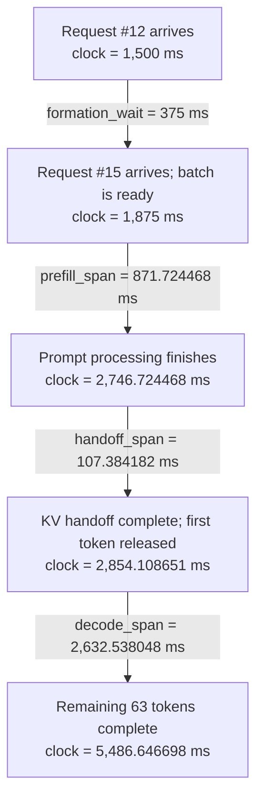

# How ServeScope turns a serving scenario into a result

The quoted values describe the **current default no-reuse run** in `examples/default-result.json`, not measured inference on an H100. Import `examples/default-scenario.json` to reproduce it. A **timestamp** locates an event on the simulation clock; a **duration** measures an interval. The clock starts at the first generated request, at 0 ms. A request arriving at 1,500 ms has not spent 1,500 ms waiting in the server.

The key dependency is:

**inputs → estimated operation/link service times → shared-resource schedule → request completion times → reported metrics.**


## 1. What is in this example?

Sixteen requests arrive at eight requests per second: one every 125 ms. Each has 2,048 input tokens and asks for 64 output tokens. Consecutive requests form groups of four. Separate prefill and decode pools each use four H100 GPUs with tensor parallelism 4 and one pipeline stage. Retained-prefix reuse is disabled and active KV is in HBM. All calculations below use the [exported default result](../examples/default-result.json).

**Prefill** processes the prompt and produces the first output token. **Decode** then generates one additional output token per iteration. **KV** means the attention key/value state: information computed from earlier tokens so the model can use that context without repeating all earlier work.

ServeScope's fixed-batch model keeps each group together here. It does not continuously merge requests into new batches like a production vLLM scheduler.

## 2. Read the four completion values as clock readings

| Label in the hover | Meaning in this run | Completion timestamp |
| --- | --- | ---: |
| `finish_3` | A representative of requests #0–3 | 2,580.707249 ms |
| `finish_7` | A representative of requests #4–7 | 4,663.790593 ms |
| `finish_11` | A representative of requests #8–11 | 5,294.054253 ms |
| `finish_last` | Request #12 represents the final group, #12–15 | 5,486.646698 ms |

IDs start at zero. In this configuration the four requests in each group finish simultaneously, so the hover lists one representative for each distinct completion time. Requests #12, #13, #14 and #15 tie for last; #12 is not uniquely slower. These IDs identify paths you can follow, not coefficients of the timing model. The representatives can change in another configuration. In particular, decode can split a prefill group when its batch cap is smaller.

The simulation ends when **all** requests have finished. Therefore it chooses the largest timestamp:

```text
run duration = max(all request completion timestamps)
             = 5,486.646698 ms = 5.486646698 seconds
```

Do not add the four completion timestamps. Work overlaps between groups and between the prefill and decode pools. This figure follows the first-arriving request in each batch. It shows actual exported service intervals; gaps within a phase are waits. Later members have shorter formation waits.


The run duration includes arrivals, startup, queues and the final drain. It is finite-run throughput, not an isolated kernel benchmark or a guarantee of steady-state peak throughput.

## 3. Follow request #12 from arrival to completion

This request belongs to the last group, #12–15. The full path is:



| Term | Plain meaning | Value for request #12 |
| --- | --- | ---: |
| `arrival` | Clock time when the request enters the system: `12 / 8 × 1000` | 1,500 ms |
| `formation_wait` | Time waiting for requests #13, #14 and #15 to arrive | 375 ms |
| `prefill_span` | Elapsed time from batch readiness to the end of prompt processing, including queues | 871.724468 ms |
| `handoff_span` | Elapsed time to move prompt KV to the decode pool; it includes link queueing if present | 107.384182 ms |
| `decode_span` | Elapsed time after first-token release until the remaining 63 tokens finish, including queues | 2,632.538048 ms |

These consecutive durations can be added **along this request's path**. Adding its arrival timestamp locates the finish on the clock:

```text
finish = 1,500 + 375 + 871.724468 + 107.384182 + 2,632.538048
       = 5,486.646698 ms
```

Its own end-to-end latency excludes the time before it arrived:

```text
request latency = finish − arrival = 3,986.646698 ms
TTFT = first-token timestamp − arrival = 1,354.108651 ms
TPOT = decode_span / 63 = 41.786318 ms per subsequent output token
```

These are request #12 metrics. The Overview averages over all sixteen requests: mean TTFT is 1,100.840637 ms and mean TPOT is 39.173953 ms. Displayed and plotted numbers are rounded; the export retains full precision.

The model deliberately releases the first token **after KV handoff**, even though prefill computes it. A real server could stream that token earlier; this is a ServeScope scheduling assumption. Request #15 has the same completion timestamp as #12 but a shorter latency because it arrives later and has no batch-formation wait.

## 4. Where do the spans come from?

A phase span includes both resource service and time waiting for resources. A GPU-stage service interval can itself contain memory stalls and communication. It does not mean arithmetic-only time or measured tensor-core busy time.

| Phase for request #12 | Modeled resource service | Waiting | Elapsed span |
| --- | ---: | ---: | ---: |
| Prefill | 592.931117 ms | 278.793351 ms | 871.724468 ms |
| KV handoff | 107.384182 ms | 0 ms | 107.384182 ms |
| Decode | 1,102.832850 ms | 1,529.705198 ms | 2,632.538048 ms |

The default processes each prompt in four 512-token chunks. Request #12's group first waits **129.585116 ms** for the prefill GPU stage to finish work for #8–11, executes its first chunk, then waits **149.208235 ms** while that other group completes another chunk. Its final two chunks run without further waits. The exported four chunk services are 147.257323, 147.907627, 148.557931 and 149.208235 ms.

Decode services are interleaved with other groups on the shared decode stage. Every request in #12–15 needs 63 decode iterations; a group iteration produces one new token for each of its four members. The 1,102.832850 ms of stage service is **shared batch work**, not four separate times to add. Its waiting time grows when other ready groups get the resource. Individual token intervals therefore vary; TPOT is their average.

### The scheduler's basic rule

Once an operation reaches its turn in a resource's FIFO queue:

```text
start = max(work-ready timestamp, previous reservation's end timestamp)
queue wait = start − work-ready timestamp
end = start + estimated service duration
```

“Previous reservation” includes work already ahead in the queue; it is not necessarily the reservation active when the request first arrived. Multiple-resource initialization and memory admission add their own dependencies in other scenarios.

For the first decode step of #12–15:

```text
work ready                  2,854.108651 ms
previous reservation ends   2,878.265977 ms   ← another batch owns the GPU stage
queue wait                     24.157327 ms
GPU-stage service              17.501562 ms
next token released         2,895.767540 ms
```

This is why “the GPU operation takes 17.5 ms” does not imply “the next token arrives in 17.5 ms”: resource availability matters too. Increasing compute speed can change both its own service and later queueing. Leaving arrival rate, memory or link constraints unchanged can limit the final improvement.

## 5. Where does estimated service time come from?

### GPU stage

The model architecture and current operation shape determine the work. GPU specifications and fitted coefficients determine the estimated operator service. The default evaluates fitted functions learned from KAIST profiles; Vidur supplies a separate FP16 cohort. New GPU/shape combinations remain extrapolations, not new measurements.

```text
GPU stage service = sum(operator services for one layer) × layers in that stage
                    + modeled endpoint services
                    + any applicable separate head fallback
```

For the first decode iteration above, batch size is four, query length is one token, context is 2,049 tokens and this pipeline stage contains all 80 layers:

```text
one layer's operator sum   = 0.216232696 ms
80 repeated layers        = 17.298615717 ms
endpoints                 = 0.202946616 ms
head fallback             = 0 ms
stage service             = 17.501562332 ms
```

The layer sum covers normalization, QKV projection, rotary position, attention, output projection, feed-forward work and two tensor-parallel all-reduces. Endpoints include embedding, final normalization, vocabulary projection and sampling as charged by the current implementation. Operator services come from fitted GPU functions or explicitly labeled analytical fallbacks; the all-reduces use the network model. This reproduces the implementation, not a claim that every runtime executes an identical kernel sequence.

In fitted mode, do not separately add `FLOPs / throughput` and `bytes / bandwidth` to a fitted operator time: its measured reference already includes compute/memory effects. The original roofline option uses a different disclosed cost rule. [GPU functions and validation](calibration.md) describe both the scope and errors.

### KV handoff link

The group has four requests, each with 2,048 prompt tokens. In this default GQA model, K and V, 8 KV heads, head width 128, 2 bytes per KV element and 80 layers give:

```text
KV bytes = 4 × 2,048 × 2 × 8 × 128 × 2 × 80
         = 2,684,354,560 bytes
link service = KV bytes / (25 × 10^9 bytes/s) × 1000 + 10 / 1000 ms
             = 107.3841824 ms
```

The four TP GPUs collectively hold the shards; do not multiply this payload by four again. Other TP geometries can replicate KV heads, and other parallelism settings require the actual exported geometry. A busy handoff channel would add queueing; it happens to add zero in this path.

## 6. How this becomes 187 tokens/s

All sixteen requests finish and each returns 64 output tokens, so:

```text
completed output tokens = 16 × 64 = 1,024
Generation throughput = 1,024 / 5.486646698 seconds
                      = 186.634944 tokens/s → displayed as 187
```

The prompt tokens are not part of this numerator. The prefill-produced first token is part of the 64 output tokens; do not count it twice. Concurrency is already included in the schedule that produced the denominator, so there is no additional “number of GPUs” or “number of batches” multiplier. Output tokens per GPU-second separately divides by the eight allocated GPUs.

`base_result` is a **unit-conversion helper in the hover interface**, not a model stage or a fitted coefficient. For this horizon it means the already-calculated 5,486.646698 ms before multiplication by 0.001 to display seconds. Elsewhere the same helper converts bytes to GB or fractions to percentages. It consumes no simulated time and adds no new physical assumption.

## 7. What changes with a prefix-reuse assumption?

The default has no reuse. An optional Mooncake-derived fraction specifies how
many prompt tokens already have ready KV in HBM. Only remaining queries execute
prefill; attention still reads the full preceding context. Decode length, KV
capacity and handoff payload remain complete. The source trace does not supply
these scenario completions or a measured cache hit rate. No physical cache policy
or cache transfer is modeled. [Source analysis and scope](prefix-reuse/README.md).

Nominal Compute/Memory/Network demand bars are analytical diagnostics, not a
measured decomposition of elapsed GPU service.
